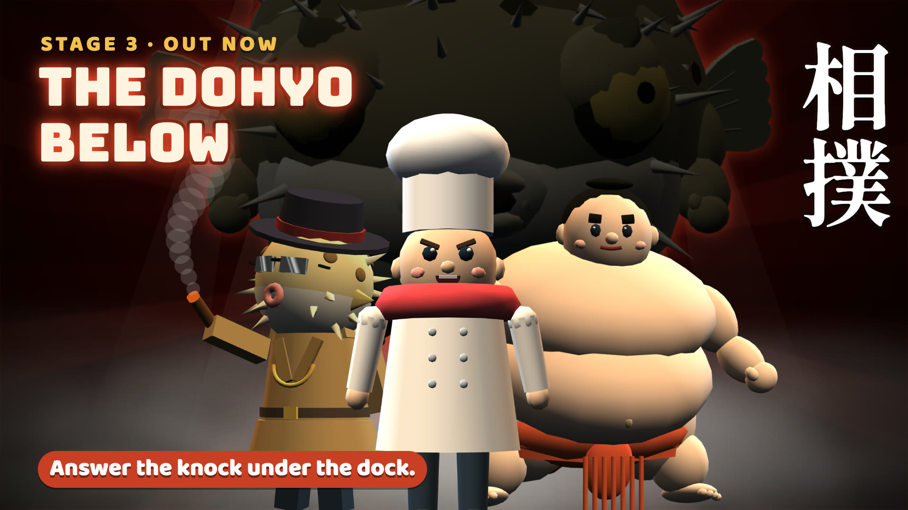
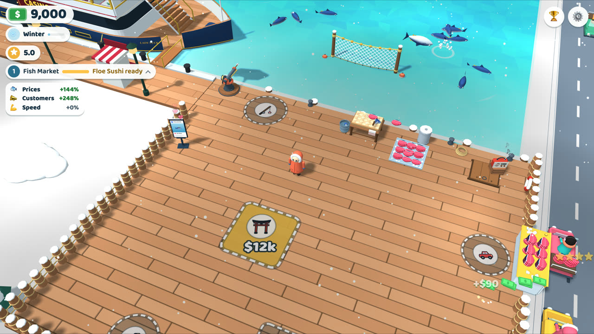
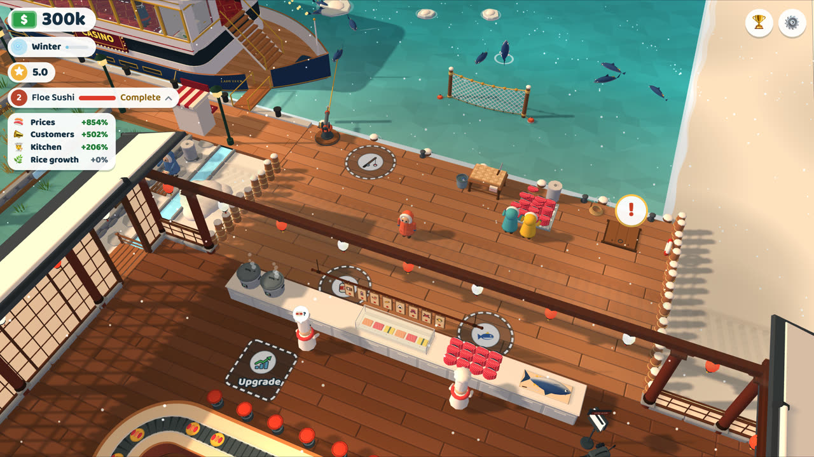
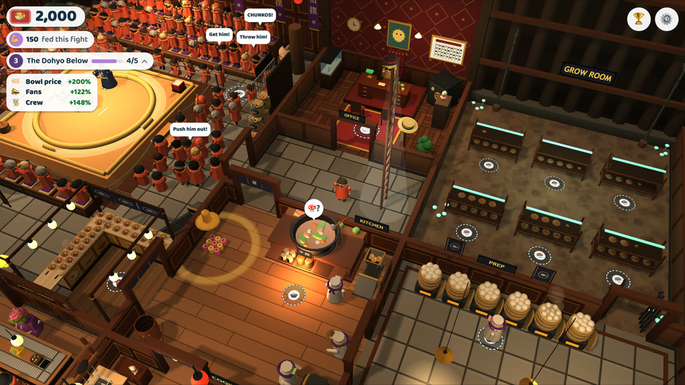
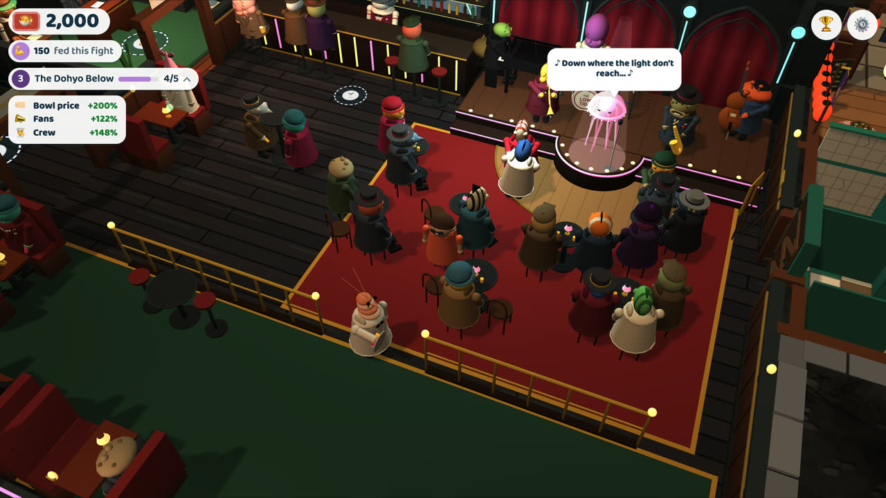

# Floe Market

A cozy 3D idle tycoon for the browser, in three stages. Start with a fish stall on the ice, grow it into Floe Sushi, a conveyor-belt restaurant with rice terraces on the hillside, then answer the knock under the dock: Mr. Fugu's illegal sumo ring is waiting in the cellar. Cook chanko for the crowd, turn each boss's fans before the bell, and buy him out.

**[Play it free in your browser](https://chefcontrol.github.io/floe-market/)**. Nothing to install; sign in with Google to keep your game on every device.

| | |
| --- | --- |
|  |  |
| **Stage 1 · Fish Market.** Hook fish, slice them and sell at the counter. | **Stage 2 · Floe Sushi.** Run the belt, grow rice on the terraces, open the kiosk. |
|  |  |
| **Stage 3 · The Dohyo Below.** Fight night in the cellar: feed the fans, beat five bosses. | **The Undertow.** Eddie, Harry and Tommy's club, for loans, fixes and a game of monte. |

## Contributing

Found a bug or have an idea? Use **⚙️ Settings → Report a bug or idea** in the game, or open a [GitHub issue](https://github.com/ChefControl/floe-market/issues). Pull requests are by invitation only.

Enjoying the game? You can [buy me a coffee](https://ko-fi.com/chefcontrol).

How the game works, running it locally, the tests and the feature flags are all in [docs/game.md](docs/game.md).

## License

Copyright © 2026 ChefControl. All rights reserved. The source is public to read, but you may not copy, modify or redistribute it without permission. See [LICENSE](LICENSE).

The recorded sounds are other people's work under their own licenses (CC BY and CC0), credited in [public/sounds/CREDITS.md](public/sounds/CREDITS.md) and under Credits & Copyrights in the game. The fonts in [public/fonts](public/fonts) are under the SIL Open Font License 1.1, with their texts beside them. The open-source libraries built into the game (three.js, html2canvas, Firebase and the code they bring) keep their own licenses: the build lists them under Credits & Copyrights and writes their full texts to `licences.txt` ([scripts/licences.ts](scripts/licences.ts)).
